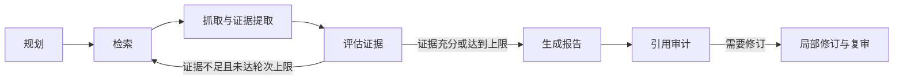

# SourceReport

SourceReport 是一个基于 LangGraph 的研究助手。输入一个研究问题，它会规划子问题、搜索公开资料、提取证据，生成带引用的报告，并检查来源是否支持报告中的结论。

你可以用它了解技术方案、比较工具，或围绕一个主题整理资料。报告、来源和研究过程保存在本地，方便回看和复核。

## 功能

- **自动研究**：将问题拆成子问题，搜索、阅读资料，并在证据不足时补充检索。
- **带来源的报告**：为报告中的结论保留引用和来源链接，方便查看原始资料。
- **引用核验**：检查引用是否支持相应陈述，对缺少支持的内容进行局部修订和复审。
- **研究过程可见**：查看研究计划、搜索查询、来源获取情况、引用审计和调用用量。
- **本地历史记录**：保存任务与报告，支持查看历史和通过命令行恢复中断的任务。
- **模型可配置**：支持 DeepSeek 和其他 OpenAI 兼容模型服务，使用 Tavily 搜索公开网页。

## 工作流



## 快速开始

需要 Python 3.11+ 和 [uv](https://docs.astral.sh/uv/)。

```bash
git clone https://github.com/Vonllya/SourceReport.git
cd SourceReport
uv sync
cp .env.example .env
```

### 配置服务

编辑项目根目录的 `.env`，填写模型和搜索服务的 API Key。以下配置使用 DeepSeek V4 Flash 与 Tavily：

```env
LLM_PROVIDER=deepseek
OPENAI_API_KEY=你的 DeepSeek API Key
OPENAI_BASE_URL=https://api.deepseek.com
OPENAI_MODEL=deepseek-v4-flash

SEARCH_PROVIDER=tavily
TAVILY_API_KEY=你的 Tavily API Key
```

密钥可分别在 [DeepSeek 开放平台](https://platform.deepseek.com/) 和 [Tavily](https://app.tavily.com/) 获取。模型与搜索调用按对应服务的规则计费。请将密钥保存在本地 `.env` 中。

### 启动界面

```bash
uv run streamlit run frontend/streamlit_app.py
```

浏览器打开 [http://127.0.0.1:8501](http://127.0.0.1:8501)。

## 使用方法

1. 输入研究问题，尽量说明关注的范围和希望比较的内容。
2. 选择最大研究轮数、来源偏好和最多抓取来源数。
3. 点击“开始研究”，等待报告生成与引用核验完成。
4. 在“研究报告”查看结论，在“过程与来源”追溯资料，在“引用核验”查看支持情况和调用用量。

例如：

> LangGraph 的持久化 checkpoint 解决了什么问题？请基于官方文档总结，并说明它对长时间运行 Agent 的价值。

研究轮数支持 1–3 轮，默认 2 轮。系统会在证据不足时继续检索，证据充分或达到研究上限后生成报告。增加轮数和来源数可能增加耗时与费用。

历史报告可从侧边栏选择，也可以删除。任务默认保存在 `data/sourcereport.db`，可通过 `SOURCEREPORT_DB` 指定其他路径。

## 如何理解研究结果

报告中的引用可以帮助你追溯证据；引用核验会标记来源对结论的支持程度。来源无法读取全文时，系统可能使用搜索摘要，并在来源列表中标明获取情况。

引用有效不等于结论一定正确。对于关键判断，建议结合审计结果打开原始资料复核，尤其留意仅有搜索摘要、部分支持或不支持的引用。

## 命令行使用

也可以在项目目录中直接发起研究：

```bash
uv run sourcereport research "LangGraph 的持久化 checkpoint 有什么价值？" --max-rounds 2
```

命令返回任务 ID 和报告。使用任务 ID 查看状态或恢复中断任务：

```bash
uv run sourcereport inspect <task-id>
uv run sourcereport resume <task-id>
```

## 可选配置

常用设置均在 `.env` 中修改，完整模板见 [.env.example](.env.example)。修改后请重启应用。

| 配置 | 默认值 | 用途 |
|---|---|---|
| `LLM_THINKING_MODE` | `disabled` | DeepSeek 思考模式，可设为 `enabled` |
| `LLM_MAX_TOKENS_STRUCTURED` | `4096` | 规划、证据提取等步骤的输出上限 |
| `LLM_MAX_TOKENS_CITATION_AUDIT` | `4096` | 引用核验的输出上限 |
| `LLM_MAX_TOKENS_REPORT` | `4096` | 报告生成的输出上限 |
| `LLM_TIMEOUT_SECONDS` | `120` | 单次模型请求超时秒数 |
| `LLM_MAX_RETRIES` | `2` | 临时服务错误的最大重试次数 |
| `SOURCEREPORT_DB` | `data/sourcereport.db` | 本地任务数据库路径 |

默认关闭 DeepSeek 思考模式，以便规划和证据提取等步骤稳定返回结构化结果，同时控制输出用量。应用不保存模型的完整推理内容。

使用其他 OpenAI 兼容模型服务时，将 `LLM_PROVIDER` 设为 `openai`，并修改 `OPENAI_API_KEY`、`OPENAI_BASE_URL` 和 `OPENAI_MODEL`。

## 常见问题

**启动后提示配置缺失**：检查 `.env` 是否位于项目根目录，是否填写了两个服务的密钥，以及 `LLM_PROVIDER` 和 `SEARCH_PROVIDER` 是否与所用服务一致。

**请求失败**：401 通常表示密钥无效，402 表示模型账户余额不足，422 表示模型或参数配置不兼容。429 为限流，500/503 为服务端异常，应用会对这些临时错误进行有限重试。

**提示输出被截断或 `finish_reason=length`**：提高对应步骤的 Token 输出上限；若开启了思考模式，也可先将 `LLM_THINKING_MODE` 改回 `disabled`。

**部分网页无法读取**：目标网站可能限制自动访问，或页面内容无法直接提取。可在“过程与来源”查看获取情况，并打开原始链接核对。

## 许可证

[MIT License](LICENSE)。
